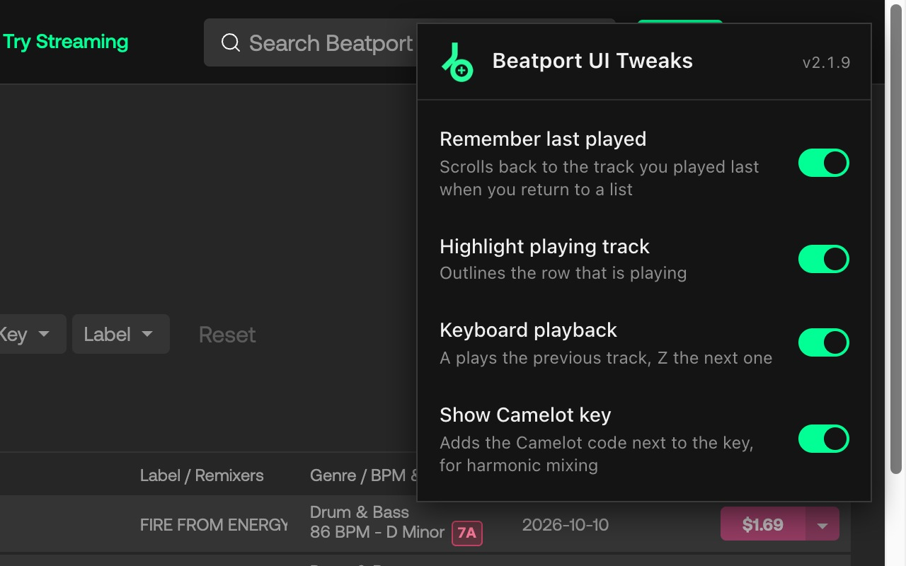
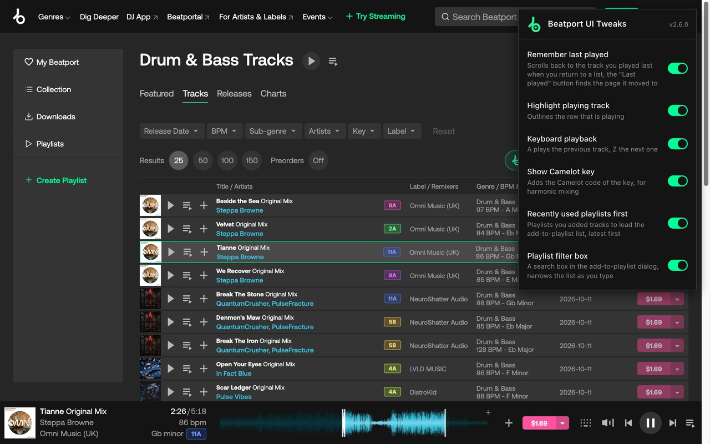
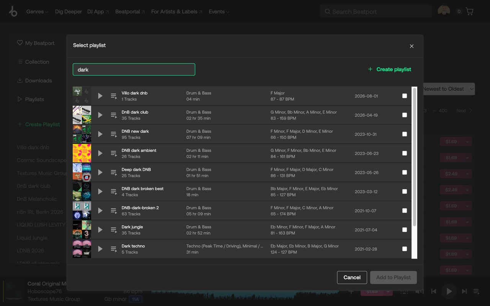
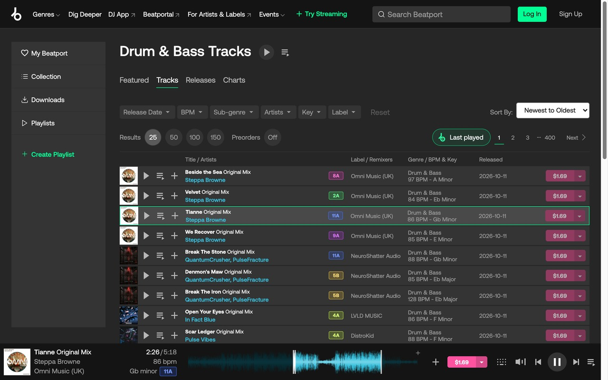

#  Beatport UI Tweaks
A web extension that adds some useful feature to [beatport.com](https://www.beatport.com/) site

## Features
- Toggle list row highlighting (on hover and last played item)
- Toggle saving last played item in local storage and highlighting it on page load and scrolling to it, with a "Last played" button next to the pager that jumps to the page the track has moved to since
- Play next or previous items with keyboard shortcuts (a -> previous, z -> next)
- Show the Camelot code in Camelot wheel colors, for harmonic mixing: one column at the end of the title cell in lists, next to the key on track pages and in the player
- Alt+Shift+B opens the popup (change it under chrome://extensions/shortcuts)
- Playlists you added tracks to come first in the add-to-playlist dialog, latest first
- A filter box in the add-to-playlist dialog, narrows the list as you type

## What's new

See the [changelog](CHANGELOG.md).

## Screenshots
### Extension

### [beatport.com](https://www.beatport.com/) with extension enabled

### Playlist filter in the add-to-playlist dialog

### "Last played" button next to the pager

## Releasing

1. The PR that bumps `version` in `package.json` and `src/manifest.json` adds the entry at the top of `CHANGELOG.md` (CI fails without it).
2. After the merge, tag main: `git tag vX.Y.Z && git push origin vX.Y.Z`. The release workflow builds the zip and publishes the GitHub release with the changelog entry as notes.
3. Upload the zip from the release page to the Chrome Web Store dashboard.

## Installation

### Chrome

From [Chrome Web Store](https://chrome.google.com/webstore/detail/beatport-ui-tweaks/cpbhbclfehplhjdfikckomhcdoppkbge)
